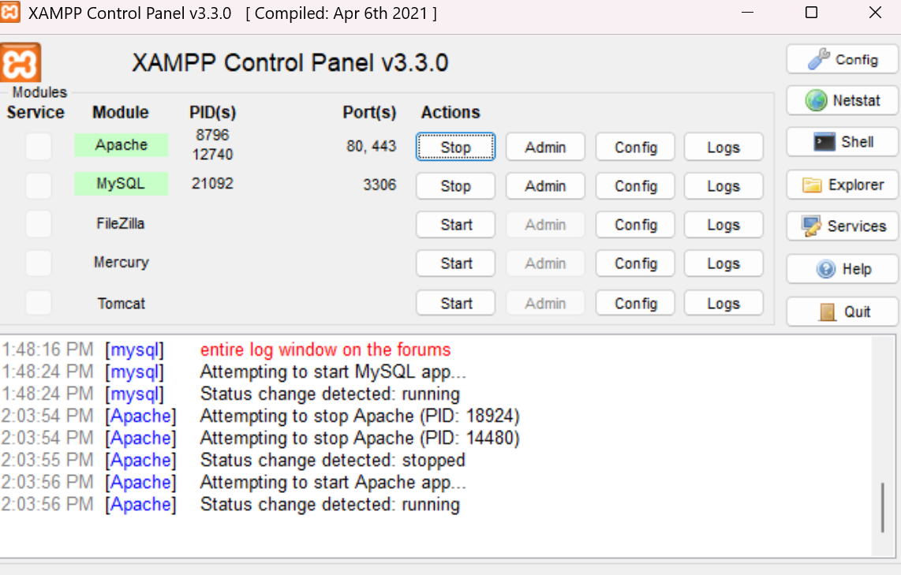
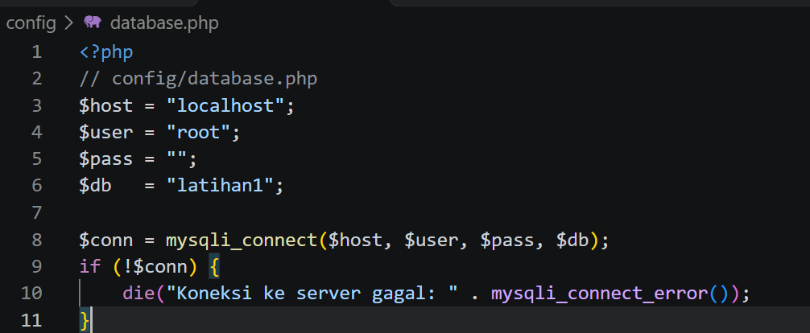
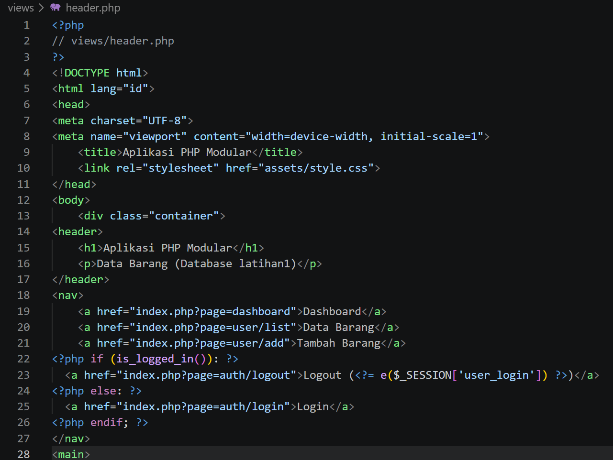
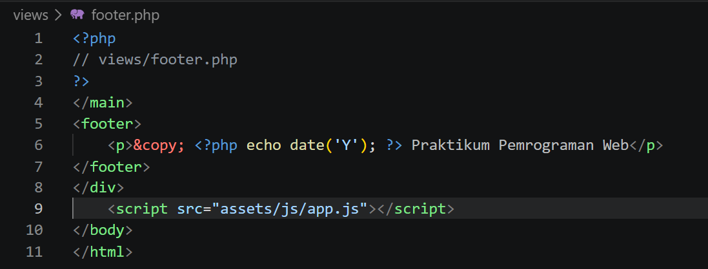
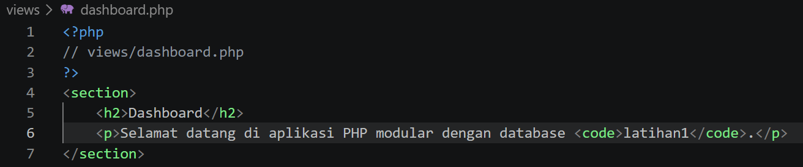

# LAPORAN PRAKTIKUM 9

## PHP MODULAR (ROUTING, LAYOUT, HELPER, DAN CRUD DATA BARANG)

### Identitas Mahasiswa

- **Nama:** UGI INSAN MULYAWAN
- **NIM:** 312510268
- **Program Studi:** Teknik Informatika
- **Mata Kuliah:** Pemrograman Web
- **Praktikum:** Praktikum 9 — PHP Modular

---

## Pengertian PHP Modular

PHP Modular adalah teknik pengorganisasian kode program PHP dengan cara memecah 
aplikasi menjadi beberapa bagian atau modul yang terpisah berdasarkan fungsinya, 
seperti konfigurasi database, fungsi bantuan (*helper*), kerangka tampilan 
(*views*), serta modul fitur utama (*modules*).

Dengan pendekatan modular, kode program tidak menumpuk di dalam satu file besar. 
Bagian layout yang berulang seperti `header` dan `footer` cukup ditulis satu 
kali lalu dipanggil menggunakan `require` atau `require_once` melalui satu titik 
masuk utama (*single entry point*) di `index.php`.

Pada praktikum ini, materi yang dipelajari meliputi perancangan struktur folder 
aplikasi modular, pemisahan koneksi database `mysqli` (`latihan1`), pembuatan 
fungsi helper (`e()`, `formatRupiah()`, `is_logged_in()`), pembuatan sistem 
*routing* berbasis parameter URL `$_GET['page']`, pemisahan layout tampilan 

(`header`, `footer`, `dashboard`), serta implementasi modul CRUD (`list`, `add`, 
`edit`, `delete`) pada tabel `data_barang` dan modul autentikasi (`login`, 
`logout`).

## Tujuan Praktikum

1. Memahami konsep pemrograman PHP Modular dan keuntungan pemisahan struktur 
kode.
2. Merancang struktur direktori aplikasi web modular (`config/`, `helpers/`, 
`views/`, `modules/`, `assets/`).
3. Memisahkan konfigurasi koneksi database `mysqli` ke dalam file tersendiri.
4. Membuat file *helper* untuk fungsi yang digunakan berulang kali di berbagai 
halaman.
5. Menerapkan sistem *routing* sederhana menggunakan parameter query `index.php?page=...`.
6. Memisahkan komponen antarmuka pengguna (`header.php` dan `footer.php`) agar 
mudah dipelihara.
7. Mengintegrasikan operasi CRUD tabel `data_barang` ke dalam struktur aplikasi 
PHP Modular.
8. Menerapkan validasi input, unggah gambar barang, serta penanganan pesan 
kesalahan (*error handling*) pada aplikasi modular.

## Struktur File

Struktur folder praktikum yang digunakan adalah sebagai berikut.

```text
Lab9_PHP_Modular/
│
├── index.php
├── README.md
│
├── images/
│
├── gambar/
│
├── config/
│   └── database.php
│
├── helpers/
│   └── functions.php
│
├── views/
│   ├── header.php
│   ├── footer.php
│   └── dashboard.php
│
├── modules/
│   ├── auth/
│   │   ├── login.php
│   │   └── logout.php
│   └── user/
│       ├── list.php
│       ├── add.php
│       ├── edit.php
│       └── delete.php
│
└── assets/
    │   └── style.css
    └── script.js
```

Keterangan:

- Folder `images/` digunakan untuk menyimpan screenshot hasil praktikum sebagai 
dokumentasi laporan pada `README.md`.
- Folder `gambar/` digunakan untuk menyimpan file gambar produk yang diunggah 
melalui form tambah dan ubah data barang.
- File `index.php` berperan sebagai *front controller* sekaligus router utama 
aplikasi yang menerima parameter `?page=...` dan memuat layout serta modul yang 
diminta.
- Folder `config/` berisi file `database.php` untuk menyimpan konfigurasi host, 
username, password, nama database (`latihan1`), serta inisialisasi koneksi 
`mysqli_connect()`.
- Folder `helpers/` berisi file `functions.php` yang menampung fungsi-fungsi 
bantu seperti `e()` untuk sanitasi output HTML (`htmlspecialchars`), 
`formatRupiah()` untuk pemformatan mata uang Rupiah, dan `is_logged_in()` untuk 
memeriksa status sesi login pengguna.
- Folder `views/` berisi komponen tampilan utama aplikasi, yaitu `header.php` 
(bagian pembuka HTML, judul aplikasi, dan menu navigasi), `footer.php` (bagian 
penutup layout), dan `dashboard.php` (halaman beranda beserta ringkasan jumlah 
data barang).
- Folder `modules/user/` berisi modul pengelolaan data barang (`data_barang`), 
yaitu `list.php` untuk menampilkan daftar barang, `add.php` untuk menambah data 
barang baru beserta upload gambar, `edit.php` untuk memperbarui data barang, dan 
`delete.php` untuk menghapus data beserta file gambarnya.
- Folder `modules/auth/` berisi modul autentikasi pengguna, yaitu `login.php` 
untuk memproses form masuk menggunakan `$_SESSION` dan `logout.php` untuk 
menghapus sesi login.
- Folder `assets/` berisi file pendukung antarmuka, yaitu `css/style.css` untuk 
pengaturan tata letak, tabel, formulir, dan kotak pesan error (`.error-msg`), 
serta `js/app.js` untuk skrip JavaScript pendukung.


## Persiapan Praktikum

### 1. Membuat Folder Praktikum dan Database

**Pembahasan:**

Langkah pertama adalah membuat folder `Lab9_PHP_Modular` di dalam 
direktori 
`htdocs` pada instalasi XAMPP (`C:\xampp\htdocs\Lab9_PHP_Modular`), 
kemudian 
menyusun sub-folder `config`, `helpers`, `views`, `modules`, 
`assets`, `gambar`, 
dan `images`.

Selanjutnya, memastikan database `latihan1` dan tabel `data_barang` 
(`id_barang`, `kategori`, `nama`, `gambar`, `harga_beli`, `harga_jual`, `stok`) 
sudah tersedia di MySQL/phpMyAdmin dari praktikum sebelumnya.

### Screenshot Struktur Folder


**Keterangan:**

Screenshot menunjukkan susunan folder dan file proyek `Lab9_PHP_Modular` di 
dalam direktori `htdocs`.

### 2. Menjalankan Server Lokal (Apache & MySQL)

**Pembahasan:**

Sebelum mengakses aplikasi, aplikasi XAMPP Control Panel dibuka lalu modul 
**Apache** dan **MySQL** dijalankan dengan menekan tombol **Start**. Apache 
berfungsi memproses skrip PHP, sedangkan MySQL melayani permintaan query ke 
database `latihan1`.

Setelah kedua layanan aktif, aplikasi dapat diakses melalui browser pada alamat:

```text
http://localhost/Lab9_PHP_Modular/
```

### Screenshot XAMPP dan Browser



**Keterangan:**

Modul Apache dan MySQL berjalan aktif di XAMPP sehingga aplikasi modular dapat 
terhubung ke database `latihan1`.

---

# LANGKAH-LANGKAH PRAKTIKUM

## 1. Konfigurasi Database (`config/database.php`)

**Pembahasan:**

File `config/database.php` dibuat untuk memusatkan pengaturan koneksi ke 
database MySQL menggunakan ekstensi `mysqli`. Dengan memisahkan konfigurasi ke 
satu file, perubahan nama database atau kredensial server cukup dilakukan di 
satu tempat saja.

Apabila koneksi gagal, pesan kesalahan disimpan ke variabel `$globalError` agar 
dapat ditampilkan secara rapi di antarmuka aplikasi.

### Screenshot Codingan



**Keterangan:**

Kode `config/database.php` menghubungkan aplikasi PHP ke database `latihan1` dan
mengatur charset `utf8mb4`.

## 2. Fungsi Helper (`helpers/functions.php`)

**Pembahasan:**

File `helpers/functions.php` berisi kumpulan fungsi bantu yang dapat dipanggil
di seluruh halaman modul maupun view. Fungsi `e()` membungkus `htmlspecialcha(`untuk mengamankan keluaran teks dari karakter HTML berbahaya, `formatRupiah()`
memformat angka harga beli dan harga jual menjadi format mata uang Rupiah, dan
`is_logged_in()` memeriksa status sesi pengguna.

### Screenshot Codingan


**Keterangan:**

Fungsi helper mengurangi penulisan kode berulang pada tampilan tabel dan
formulir.

## 3. Router Utama (`index.php`)

**Pembahasan:**

File `index.php` bertindak sebagai pengendali utama (*router*) yang membaca
parameter URL `$_GET['page']`. Daftar rute yang diizinkan didefinisikan di dalam
array `$routes` sehingga permintaan halaman dipetakan secara aman ke file modul
atau view yang sesuai.

Sebelum memuat `views/header.php`, `index.php` menangani aksi yang membutuhkan
pengalihan halaman (`header("Location: ...")`) seperti proses `auth/logout`
`user/delete`, dan pengiriman form `POST` agar tidak terjadi kendala *headers
already sent*.

### Screenshot Codingan


### Hasil Browser


**Keterangan:**

Ketika alamat `http://localhost/Lab9_PHP_Modular/` dibuka tanpa parameter `page`, router 
otomatis menampilkan halaman `views/dashboard.php`.

## 4. Pemisahan Layout (`views/header.php`, `views/footer.php`, `views/dashboard.php`)

**Pembahasan:**

Kerangka HTML utama dipisahkan menjadi `views/header.php` dan `views/footer.php`. File 
`header.php` memuat tag pembuka HTML, pemanggilan `assets/css/style.css`, judul aplikasi, 
serta menu navigasi dinamis (`Dashboard`, `Data Barang`, 
`Tambah Barang`, dan `Login`/`Logout`).

Sementara itu, `views/dashboard.php` menampilkan informasi sambutan, ringkasan 
total data barang dari tabel `data_barang`, serta tempat menampilkan pesan error 
apabila terjadi pengalihan dengan parameter error.

### Screenshot Codingan







### Hasil Browser


**Keterangan:**

Setiap halaman modul memiliki tampilan header, menu navigasi, dan footer yang 
seragam tanpa perlu menyalin struktur HTML di setiap file.

## 5. Modul Data Barang — Read (`modules/user/list.php`)

**Pembahasan:**

File `modules/user/list.php` digunakan untuk membaca dan menampilkan seluruh 
data dari tabel `data_barang` menggunakan `mysqli_query()`. Data ditampilkan 
dalam bentuk tabel HTML lengkap dengan pratinjau gambar barang, pemformatan 
harga menggunakan `formatRupiah()`, jumlah stok, serta tombol aksi **Ubah** dan 
**Hapus**.

### Screenshot Codingan


### Hasil Browser


**Keterangan:**

Halaman `index.php?page=user/list` menampilkan daftar data barang yang tersimpan 
pada database `latihan1`.

## 6. Modul Data Barang — Create (`modules/user/add.php`)

**Pembahasan:**

File `modules/user/add.php` menyediakan formulir penambahan barang baru 
menggunakan metode `POST` dan atribut `enctype="multipart/form-data"` untuk 
mendukung unggah file gambar.

Di sisi server, masukan pengguna divalidasi terlebih dahulu, tipe MIME gambar 
diperiksa menggunakan `finfo` (mendukung JPG, PNG, dan WEBP), dan data disimpan 
ke tabel `data_barang` menggunakan *prepared statement* (`mysqli_prepare()`). 
Jika terjadi kesalahan input atau upload, pesan error ditampilkan di atas form 
melalui elemen `.error-msg`.

### Screenshot Codingan


### Hasil Browser


**Keterangan:**

Data barang baru yang lolos validasi tersimpan ke tabel `data_barang` dan 
pengguna langsung diarahkan kembali ke halaman `user/list`.

## 7. Modul Data Barang — Update & Delete (`modules/user/edit.php` & `modules user/delete.php`)

**Pembahasan:**

File `modules/user/edit.php` mengambil data barang berdasarkan `id_barang` dari 
parameter URL, menampilkan nilai lama pada kolom formulir beserta pratinjau 
gambar, lalu memperbarui data ke database menggunakan query `UPDATE` dengan 
*prepared statement*. Jika pengguna mengunggah gambar baru, file gambar lama 
akan dihapus dari folder `gambar/`.

File `modules/user/delete.php` memproses penghapusan data berdasarkan 
`id_barang` menggunakan query `DELETE`, menghapus file gambar terkait jika ada, 
lalu mengarahkan pengguna kembali ke daftar barang (`user/list`).

### Screenshot Codingan


### Hasil Browser


**Keterangan:**

Perubahan data barang berhasil diperbarui di database, dan fitur hapus menghapus 
baris data sekaligus membersihkan file gambar dari server.

## 8. Modul Autentikasi (`modules/auth/login.php` & `modules/auth/logout.php`)

**Pembahasan:**

Modul autentikasi mengelola sesi pengguna menggunakan `$_SESSION`. Pada 
`modules/auth/login.php`, form menerima input `username` dan `password` dengan 
metode `POST`. Jika kredensial sesuai, sesi `$_SESSION['user_login']` dibuat dan 
menu navigasi pada `header.php` berubah menjadi **Logout**.

Pada `modules/auth/logout.php`, sesi dihancurkan menggunakan `session_destroy()` 
dan pengguna diarahkan kembali ke halaman login.

### Screenshot Codingan


### Hasil Browser


**Keterangan:**

Fitur login dan logout berjalan menggunakan sesi PHP dan terintegrasi langsung 
dengan sistem routing `index.php`.

## 9. Styling CSS dan Script JavaScript (`assets/`)

**Pembahasan:**

File `assets/style.css` digunakan untuk mengatur tata letak halaman, navigasi, tabel data barang, formulir, serta tampilan pesan kesalahan (`.error-msg`). Sementara itu, file `assets/script.js` digunakan untuk skrip JavaScript pendukung antarmuka yang dimuat pada bagian layout.

### Screenshot Codingan


**Keterangan:**

Screenshot menampilkan aturan gaya tampilan pada `assets/style.css` serta skrip pendukung pada `assets/script.js`.

---

# PENGUJIAN VALIDASI DAN ERROR HANDLING

Pengujian dilakukan untuk memastikan mekanisme validasi dan tampilan pesan error 
(`.error-msg`) bekerja sesuai ketentuan:

1. **Pengujian input form kosong atau nilai negatif pada `add.php` / `editphp`:**
   Program menolak penyimpanan data dan menampilkan pesan kesalahan berwarna 
   merah di bagian atas formulir.
2. **Pengujian format file gambar tidak sesuai:**
   Jika file yang diunggah bukan berformat JPG, PNG, atau WEBP, sistem 
   menampilkan pesan *"Format gambar harus JPG, PNG, atau WEBP."*
3. **Pengujian login dengan username/password salah:**
   Halaman `auth/login` menampilkan pesan *"Username atau password salah."* 
   tanpa membuat sesi login.
4. **Pengujian rute halaman tidak dikenal pada `index.php`:**
   Parameter `?page=...` yang tidak terdaftar di array `$routes` otomatis
   dialihkan ke halaman default (`dashboard`) sehingga mencegah akses file
   sembarangan (*directory traversal*).

---

# PERTANYAAN EVALUASI

## 1. Pengertian Modularisasi Program dan Minimal Tiga Manfaatnya
Modularisasi program adalah pendekatan menyusun program ke dalam bagian-bagian atau modul 
terpisah yang masing-masing memiliki tanggung jawab spesifik, lalu digabungkan untuk 
membentuk aplikasi yang utuh.

Manfaatnya:

Lebih mudah dirawat dan diperbaiki: jika ada bug pada fitur tertentu (misalnya ubah data atau 
koneksi database), perbaikan cukup dilakukan pada file/modul terkait tanpa harus membongkar 
seluruh kode.

Dapat digunakan kembali (reusable): kode umum seperti koneksi database, fungsi bantu 
(helpers), atau potongan tampilan (header/footer) dapat dipakai ulang di berbagai bagian 
aplikasi.

Lebih terstruktur dan mudah dipahami: pembagian tugas per folder/file membuat alur program 
lebih rapi dan memudahkan kerja tim.

## 2. Perbedaan include dan require Ketika File Tidak Ditemukan
include: menghasilkan warning (E_WARNING) jika file tidak ditemukan, tetapi eksekusi skrip 
tetap dilanjutkan ke baris berikutnya.

require: menghasilkan fatal error (E_COMPILE_ERROR / E_ERROR) jika file tidak ditemukan dan 
menghentikan eksekusi skrip pada titik tersebut.

## 3. Mengapa require_once Sesuai Digunakan untuk Memuat Konfigurasi Database?
require_once memastikan file konfigurasi database (seperti config/database.php) wajib ada 
agar aplikasi tidak berjalan tanpa koneksi/konfigurasi, sekaligus mencegah pemuatan ulang 
berulang kali dalam satu request yang sama (yang bisa memicu duplikasi deklarasi variabel/
fungsi atau membuka koneksi berulang).

## 4. Perbedaan Parameter, Argumen, dan Nilai return pada Function
Parameter: variabel placeholder yang ditulis pada definisi/deklarasi function untuk menerima 
nilai masukan.

Argumen: nilai atau data aktual yang dikirimkan ke function saat function dipanggil.

Nilai return: nilai hasil pemrosesan yang dikembalikan oleh function ke pemanggilnya 
menggunakan keyword return (dan sekaligus mengakhiri eksekusi di dalam function tersebut).

## 5. Mengapa header dan footer Sebaiknya Dipisahkan dari Konten Halaman?
Agar struktur halaman (seperti tag HTML pembuka, pemanggilan CSS/JS, navigasi, dan bagian 
kaki halaman) konsisten di seluruh halaman dan tidak ditulis berulang-ulang. Jika ada 
perubahan menu navigasi atau gaya tampilan umum, cukup ubah satu file saja.

## 6. Fungsi index.php pada Pola Routing yang Dipraktikkan
index.php bertindak sebagai titik masuk utama (front controller / router) yang memulai 
session, memuat file konfigurasi dan helper, membaca parameter rute (misalnya $_GET['page']), 
menentukan file modul/tampilan yang harus dijalankan, lalu menampilkannya di dalam kerangka 
layout.

## 7. Mengapa Router Sebaiknya Menggunakan Whitelist Rute?
Whitelist rute (misalnya daftar rute valid yang diizinkan pada array $routes) membatasi akses 
hanya ke halaman atau modul yang memang terdaftar secara eksplisit. Rute yang tidak ada di 
daftar bisa ditolak atau dialihkan dengan aman, sehingga mencegah akses ke file internal yang 
tidak seharusnya dipanggil langsung lewat parameter URL.

## 8. Risiko Jika Input page Langsung Digabungkan Menjadi Path File yang Di-require
Jika nilai input (seperti $_GET['page']) langsung digabung ke path file tanpa validasi/
whitelist, penyerang dapat melakukan serangan Local File Inclusion (LFI) atau path traversal 
(misalnya menyisipkan ../ untuk mengarah ke file lain di server) atau memicu pemuatan file 
yang tidak dimaksudkan, yang berpotensi membocorkan informasi sensitif atau menjalankan kode 
yang tidak aman.

## 9. Fungsi Aturan RewriteCond dan RewriteRule pada .htaccess
Pada modul mod_rewrite Apache:

RewriteCond (Rewrite Condition): menetapkan syarat/kondisi tertentu yang harus terpenuhi 
sebelum aturan penulisan ulang dijalankan (misalnya memeriksa apakah permintaan bukan file 
nyata atau bukan direktori yang ada).

RewriteRule (Rewrite Rule): menentukan pola URL yang dicocokkan dan tujuan pengalihan/
penulisan ulangnya (misalnya mengarahkan URL rapi seperti /user/list ke index.php?page=user/
list).

## 10. Bagian Aplikasi CRUD yang Paling Tepat Dipindahkan ke config, views, helpers, dan modules
config/: pengaturan dan koneksi database (database.php untuk database latihan1 dan koneksi 
mysqli).

views/: komponen antarmuka/tampilan halaman seperti layout utama (header.php, footer.php) dan 
tampilan ringkasan (dashboard.php).

helpers/: fungsi utilitas/bantuan yang dipakai lintas halaman (functions.php, seperti fungsi 
escape HTML e() atau pemformatan angka/rupiah).

modules/: logika fitur dan proses CRUD per domain, misalnya modules/user/ (list.php, add.php, 
edit.php, delete.php untuk mengelola tabel data_barang) serta modules/auth/ (login.php, 
logout.php).

---

# KESIMPULAN

Berdasarkan Praktikum 9 PHP Modular, dapat disimpulkan bahwa penerapan konsep
modularisasi membuat struktur aplikasi web jauh lebih rapi, terorganisir, dan
mudah dikembangkan dibandingkan menyatukan seluruh logika dan tampilan dalam
satu file.

Melalui pemisahan `config/database.php`, `helpers/functions.php`, komponen
tampilan di `views/`, serta fitur CRUD dan autentikasi di `modules/`, setiap
bagian kode memiliki tanggung jawab yang jelas. Sistem *routing* terpusat pada
`index.php` mempermudah pengelolaan navigasi antarhalaman sekaligus menjaga
konsistensi tata letak antarmuka pengguna.

---

# DOKUMENTASI

Seluruh screenshot codingan dan hasil tampilan browser disimpan di dalam folder
`images/` pada direktori `Lab9_PHP_Modular`. Pastikan nama file gambar pada
folder `images/` sesuai dengan tautan gambar yang tercantum di dalam `README.md`
sebelum diunggah ke repository GitHub.